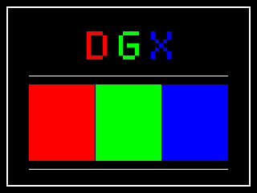

# TI_DRIVER

A small RGB565 framebuffer library and demo for the TI-84 Plus CE. This project
grew from a single-file experiment that drew **DGX** directly into LCD memory.
It is a CE program and C source library, not a replacement for the calculator's
operating-system display driver.



The preview is rendered by the same portable drawing code used by the calculator
program. It is not a calculator or emulator screenshot.

## Build the calculator program

Install [CE C/C++ Toolchain v15.0](https://ce-programming.github.io/toolchain/static/getting-started.html)
and put its `CEdev/bin` directory on your `PATH`. Then run:

```sh
make
```

The output is `bin/TIFBDEMO.8xp`. It draws the DGX label and RGB color bars,
waits for a key, clears the screen, and exits. The demo targets the TI-84 Plus
CE's 320 × 240, 16-bit framebuffer. A compatible CE OS/program launcher is
required to run native code; see the toolchain's compatibility note before
transferring the program.

## Use the library in another CE project

Copy `src/ti84fb.c`, `src/ti84fb.h`, `src/ti84fb_ce.c`, and
`src/ti84fb_ce.h` into that project's `src/` directory:

```c
#include "ti84fb_ce.h"

ti84fb_t screen = ti84fb_ce_screen();
ti84fb_fill(&screen, TI84FB_BLACK);
ti84fb_put_pixel(&screen, 10, 10, TI84FB_RED);
ti84fb_fill_rect(&screen, 20, 20, 40, 30, TI84FB_BLUE);

uint16_t color;
if (ti84fb_get_pixel(&screen, 10, 10, &color)) {
    /* color is TI84FB_RED */
}
```

Coordinates outside the surface are ignored. `ti84fb_get_pixel` returns
`false` for invalid coordinates or a null output pointer. `ti84fb_fill_rect`
clips partially visible rectangles. The caller is responsible for providing a
buffer large enough for `width * height` pixels when constructing a custom
`ti84fb_t` surface.

`ti84fb_ce_screen()` uses the LCD address and dimensions from the toolchain's
`<sys/lcd.h>`. It assumes the normal 16-bit RGB565 LCD mode. The optional
`ti84fb_ce_set_backlight()` function writes the hardware brightness register;
0 is brightest and 255 is darkest. The demo leaves brightness alone.

## Validate without a calculator

The portable drawing code can be tested on a desktop:

```sh
sh tests/run.sh
cc -std=c11 -Wall -Wextra -Werror -pedantic -Isrc \
  tests/render_preview.c src/ti84fb.c src/demo.c -o render-preview
./render-preview demo.ppm
```

The tests cover pixel boundaries, reading, fills, clipped rectangles, and
expected demo colors. GitHub Actions runs these tests and builds the `.8xp` on
each push and pull request.

## Verification status

- Built with CE C/C++ Toolchain v15.0 on macOS arm64.
- Host tests passed; host-rendered preview inspected.
- CEmu execution and physical calculator behavior remain unverified. CEmu
  requires a ROM dumped from a calculator, which is not available for this
  project. Do not infer hardware speed or compatibility from the host preview.
- No performance claim versus GraphX is made. This project uses direct 16-bit
  framebuffer writes and does not provide double buffering or frame sync.

## License

MIT. See [LICENSE](LICENSE).
